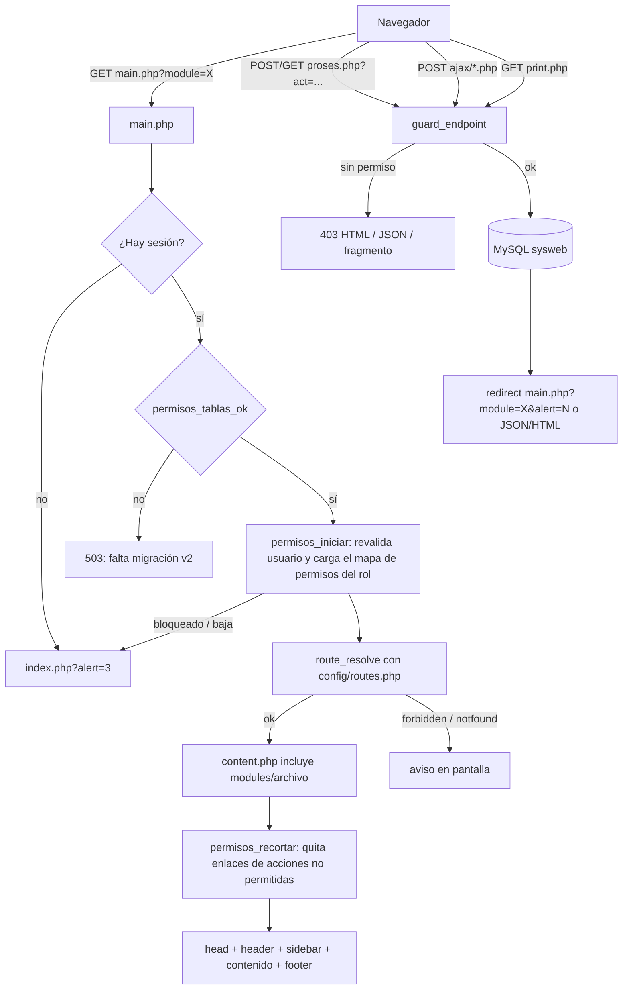
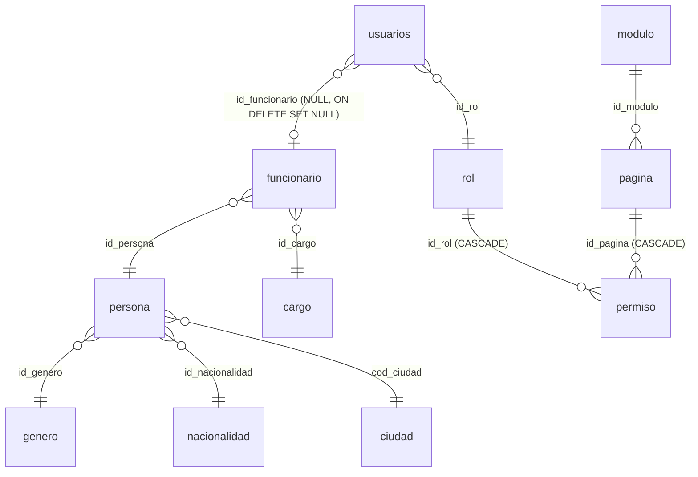

# Arquitectura de Sysweb

## Visión general

Sysweb es una aplicación PHP **procedural, sin framework**, servida por Apache (XAMPP) directamente desde
`htdocs/Proyecto2`. No hay paso de build ni gestor de dependencias en uso: todo lo necesario está versionado.

Hay tres tipos de puntos de entrada:

1. **Pantallas**: siempre `main.php?module=<clave>`. `main.php` arma la plantilla y `content.php` incluye el archivo
   de la ruta. Las vistas no se abren directo por URL.
2. **Endpoints** que el navegador llama directo: `modules/<m>/proses.php` o `process.php` (altas, bajas, cambios),
   `ajax/*.php` y `modules/<m>/ajax/*.php` (fragmentos HTML o JSON), y `modules/<m>/print.php` (PDF).
3. **Acceso público**: `index.php` (login), `login-check.php`, `logout.php` y `modules/recuperar/*` (recuperación
   de contraseña).

## Flujo de una petición

## Módulos principales

| Pieza | Archivo(s) | Responsabilidad |
|---|---|---|
| Conexión | `config/database.php` | `$mysqli` (utf8mb4), también en `$GLOBALS['mysqli']` para usarlo dentro de funciones |
| Autenticación | `config/auth.php`, `login-check.php` | bcrypt (`password_hash`), migración automática de hashes MD5 antiguos al iniciar sesión, política de contraseña (`AUTH_MIN_PASSWORD = 12`), bloqueo a `AUTH_MAX_INTENTOS = 3`, registro en `log_accesos`, correo con PHPMailer y token de recuperación (`AUTH_TOKEN_MINUTOS = 15`) |
| Autorización (RBAC) | `config/permisos.php` | `permisos_iniciar()`, `puede()`, `guard_endpoint()`, `permisos_recortar()` |
| Router | `config/routes.php`, `config/layout.php` (`route_resolve`) | Mapa `?module=` → archivo, título, módulo y acciones que aplican |
| Menú | `config/menu.php`, `config/layout.php` (`menu_filter`, `menu_render`), `layout/sidebar.php` | Árbol anidable; un ítem se ve si el rol tiene `leer` sobre esa página |
| Interfaz | `config/ui.php`, `layout/*` | `h()`, `ui_alertas()`, `ui_cabecera()`, `ui_estado_badge()`, `proses_volver()`, `ui_auditar()` |
| Catálogos | `config/catalogo.php` | Motor genérico de tablas "descripción + estado" (género, nacionalidad, cargo) |
| Personal | `modules/persona`, `modules/funcionario` | Personas y funcionarios; dar de baja a un funcionario bloquea su usuario |
| Seguridad | `modules/rol`, `modules/permiso`, `modules/pagina`, `modules/user`, `modules/accesos` | Roles, matriz de permisos, catálogo de páginas/módulos (botón "Sincronizar"), usuarios, registro de accesos |
| Compras (heredado) | `modules/pedido`, `presupuesto`, `orden_c`, `compras`, `cuenta`, `nota_c_d`, `ajuste`, `nota_remision`, `stock`, `info_*` + `ajax/` | Movimientos de compra con detalle cargado por AJAX y reportes PDF |
| Ventas (oculto) | `modules/clientes`, `pedido_v`, `ventas`, `info_pedido_v` | Rutas registradas pero el grupo tiene `'hidden' => true` en el menú |

## Modelo de control de acceso

FK tomadas de `database/migraciones/v1_a_v2_personas_permisos.sql`. La migración también pasa tablas de MyISAM a
InnoDB para tener claves foráneas y transacciones.

- `permiso` guarda, por rol y página, cuatro banderas: `perm_leer`, `perm_insertar`, `perm_editar`, `perm_borrar`.
- `pagina.pag_acciones` limita qué acciones tienen sentido en esa página (ej. los informes solo `leer`).
- Un rol con `rol_protegido = 1` (Super Admin) tiene todo; las páginas de `PERM_PAGINAS_BASICAS`
  (`start`, `perfil`, `password`) las tiene cualquier rol activo.
- **Qué acción exige cada cosa**:
  - Rutas: listados = `leer`; `form_*` según `?form=add` (insertar), `edit` (editar) o `detalle` (leer).
  - Endpoints: según `?act=` (`accion_desde_act()`); acciones auxiliares (`'cualquiera'`) piden insertar o editar.
- `permisos_recortar()` recorre el HTML generado y elimina `<a href>` hacia `form_*` o `proses.php?act=` que el rol
  no puede usar. Es solo cosmético: la barrera real es `route_resolve()` + `guard_endpoint()`.
- Los permisos se recargan desde la base **en cada petición**, así que un cambio de rol o un bloqueo rige al instante.

## Dos generaciones de código

| | Código nuevo (v2, 10/2026) | Código heredado (compras/ventas) |
|---|---|---|
| SQL | `prepare()` + `bind_param` | `mysqli_query` con valores interpolados, a veces sin escapar |
| Salida | `h()` | `echo` directo |
| Errores | `try/catch`, `proses_volver(..., alert)` o `persona_error()` que conserva lo tecleado | `die(mysqli_error())`, `alert()` de JS + `history.back()` |
| Respuesta | redirect con `alert=N` | redirect, JSON (`pedido/proses.php`) o fragmentos HTML |

Al modificar código heredado, conviene llevar a lo nuevo **la parte que se toca**, sin reescribir el módulo entero.

## Base de datos y versiones

- Base `sysweb` (MySQL/MariaDB, utf8mb4). Versión actual del esquema: **v2** (`esquema_version`).
- `database/backups/vN_*.sql`: volcado completo por versión (incluye `DROP TABLE IF EXISTS`).
- `database/migraciones/v(N-1)_a_vN_*.sql`: migración idempotente que registra su versión.
- Tablas temporales de detalle: `tmp` (por `session_id`, estado `BORRADOR`) para los movimientos de compra.
- Detalles en `database/backups/README.md`.

## Dependencias externas

| Dependencia | Dónde | Uso |
|---|---|---|
| AdminLTE 4, Bootstrap 5, Bootstrap Icons, OverlayScrollbars | `assets/adminlte/` (local) | Plantilla |
| jQuery 3.7.1, DataTables 1.13.6, Select2 4.0.13 | CDN (`code.jquery.com`, `cdn.datatables.net`, `cdnjs`, `jsdelivr`) en `layout/head.php` | Tablas y selects; requieren internet |
| Html2Pdf (spipu) / TCPDF | `assets/plugins/vendor/` | Reportes `print.php` |
| PHPMailer | `PHPMailer/src/` (cargado a mano en `config/auth.php`) | Correo de recuperación y alertas de bloqueo |
| Servidor SMTP | `config/mail.php` (no versionado; plantilla en `config/mail.example.php`) | STARTTLS; el proveedor concreto se configura localmente |
| Composer `vendor/` | raíz | Contiene otra copia de PHPMailer que **no se usa** (por confirmar si se elimina) |
